# openwebui-comfyui-local

> 把 **ComfyUI** 接成 **Open WebUI** 里的一个"模型"：选好比例，打字，回车，出图。
> 纯本地、无云端 API、无内容审核，手机在同一 WiFi 下也能用。

<p>
  
  
  
  
</p>

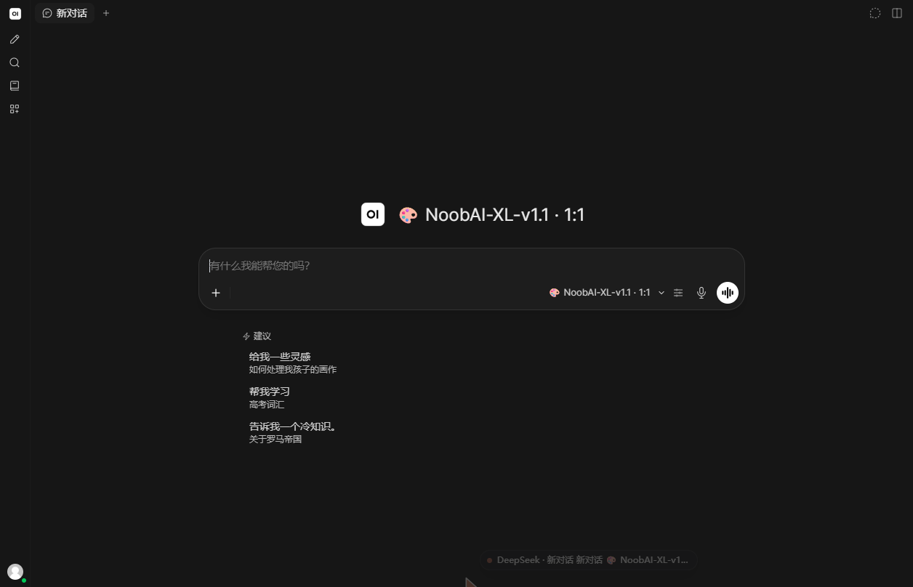

---

## 目录

- [这是什么 / 解决什么问题](#这是什么--解决什么问题)
- [效果](#效果)
- [它是怎么工作的（原理拆解）](#它是怎么工作的原理拆解)
- [快速开始](#快速开始)
- [截图导览：每一步该点哪里](#截图导览每一步该点哪里)
- [参数与 8GB 显存调优](#参数与-8gb-显存调优)
- [排错](#排错)
- [仓库结构](#仓库结构)
- [参考与同类项目](#参考与同类项目)
- [已知限制](#已知限制)

---

## 这是什么 / 解决什么问题

ComfyUI 是节点式工作流，功能强但**不像 ChatGPT**：要先连节点、填参数、点运行。
Open WebUI 是类 ChatGPT 的界面，但它自带的"图像生成"只是给**聊天模型**用的一个工具（模型要能 function calling），默认并不会把图像模型放进模型下拉框。

于是常见的一步卡在这里：**图像引擎配好了、API 能出图了，但界面上下拉框永远是"暂无可用模型"。**

这个仓库给的是一个已经跑通的组合拳：

| 层 | 用什么 | 说明 |
|-|-|-|
| 界面 | Open WebUI | 居中输入框、Enter 发送、移动端自适应 |
| 桥 | 一个 Open WebUI **Pipe 函数**（`pipe/xiaoyu_img.py`） | 把 ComfyUI 的 checkpoint × 比例声明成"模型"，收到消息就去 `/prompt` 出图 |
| 后端 | ComfyUI | 只负责执行工作流 |

装完之后你会得到：在 Open WebUI 的下拉框里看到

```
🎨 NoobAI-XL-v1.1 · 1:1     1024×1024
🎨 NoobAI-XL-v1.1 · 3:4      832×1216
🎨 NoobAI-XL-v1.1 · 9:16     768×1344
🎨 NoobAI-XL-v1.1 · 16:9    1344×768
```

选一个、打字、回车，20~30 秒出图。**换模型不用改代码**：往 `models/checkpoints/` 里丢新模型、重启 ComfyUI，下拉里自动多出 4 条。

---

## 效果

四个比例，同一个模型、同一套参数，只改画面尺寸（单张原图在 `images/effect-*.jpg`）：

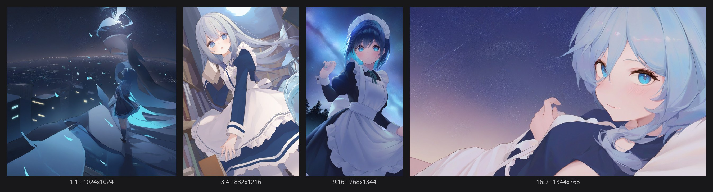

图生图（上传一张参考图 + 一句话，低幅度重绘）：


实测耗时（RTX 5060 Laptop **8GB** 显存、NoobAI-XL / SDXL、28 步）：

| 尺寸 | 首张（含加载模型） | 之后 |
|-|-|-|
| 832×1216 | ~38 s | **25~27 s** |
| 1024×1024 | ~32 s | 26 s |
| 768×1344 | ~28 s | 26 s |
| 1344×768 | ~30 s | 26 s |

显存峰值约 7.5 GB / 8 GB。

---

## 它是怎么工作的（原理拆解）

三层：**浏览器 → Open WebUI（服务端）→ ComfyUI**。浏览器从不直接碰 ComfyUI 的生成接口（只有最后的图片是浏览器直连 ComfyUI 的 `/view` 拉的，见下文第 5 步）。

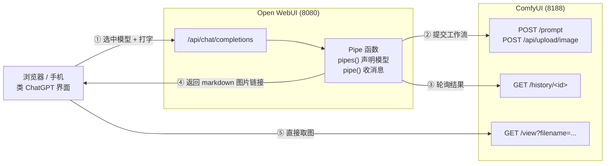

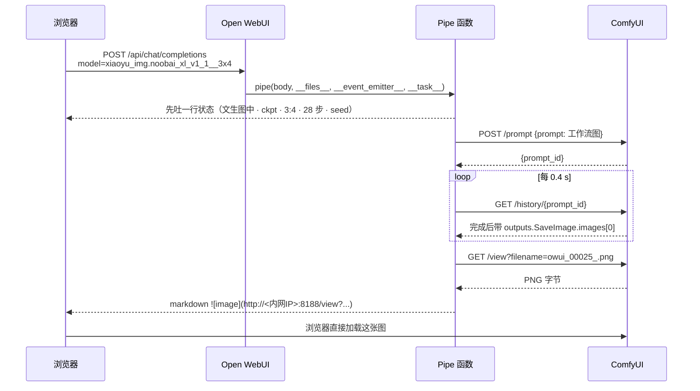

### 1. Open WebUI 里"模型"到底是什么

Open WebUI 把所有可对话的东西统一成 "model"：`GET /api/models` 返回一个列表，每个条目有 `id` / `name` / 能力标记。发消息时 `model` 字段就是这个 `id`。

模型来源有几类：Ollama、OpenAI 兼容网关、**Function（函数）**。我们用的是最后一类里的 **manifold（管汇）** 能力。

### 2. 为什么"内置图像引擎"这条路在 0.13.x 走不通

Open WebUI 确实内置了 ComfyUI 引擎（`open_webui/routers/images.py`、`utils/images/comfyui.py`）：

- 后端会去问 ComfyUI 的 `/object_info`，把 `CheckpointLoaderSimple` 的 `ckpt_name` 候选全读出来 —— 所以"能读全部模型"这件事它本来就会；
- `GET /api/v1/images/models` 返回这个列表；
- `POST /api/v1/images/generations` 能直接出图（我们实测 26 s）。

**但 0.13.x 的前端从来不请求 `/api/v1/images/models`。**（证据：把前端产物 `frontend/_app` 逐字节搜过，`images/models` 这个字符串一次都不存在。）所以不论后台怎么配，"模型下拉框"里永远没有图像模型。界面上的"图片"开关只是给**聊天模型**打开 `generate_image` 工具用的，需要模型自己能 function calling。

结论：想要"输入即出图"，必须有一个**真正的模型条目**。这就是本仓库那个 Pipe 的来历。

### 3. Pipe（manifold）是怎么变成"4 个模型"的

Open WebUI 会 import 你的函数文件，找模块级 `Pipe` 类，然后：

```python
# open_webui/functions.py（简化）
if hasattr(module, "pipes"):                    # manifold
    for p in await module.pipes():              # 我们返回 4N 条
        models.append({
            "id": f"{pipe.id}.{p['id']}",       # xiaoyu_img.noobai_xl_v1_1__3x4
            "name": p["name"],                  # 🎨 NoobAI-XL-v1.1 · 3:4
        })
```

`id` 只能是字母数字，所以 checkpoint 名要做 slug（`NoobAI-XL-v1.1.safetensors` → `noobai_xl_v1_1`），比例用 `__3x4` 后缀粘在后面。等用户发消息时，`body["model"]` 就是这整个字符串，函数里拆回来就知道"哪个模型 + 哪个比例"。

`pipes()` 里我们会实时问 ComfyUI 有哪些 checkpoint（60 秒缓存），所以新增模型不用改代码。

### 4. 函数能拿到什么、拿不到什么（踩过的坑）

```python
async def pipe(self, body, __user__, __files__, __event_emitter__, __task__=None, **kwargs)
```

- `body`：请求体，`messages` 里最后一条 user 消息就是提示词；`model` 是完整 id。
- `__files__`：用户上传的附件列表（图生图要用）。
- `__event_emitter__`：可以往前端推"状态气泡"（那句 `文生图中 · ...` 就是它）。
- `__task__`：**这个很关键**。Open WebUI 会拿同一个模型去跑后台任务（生成对话标题、生成标签），如果不管它，**一条用户消息会出 3 张图**。

而 Open WebUI 只把**函数签名里显式声明的 `__xxx__`** 传进来：

```python
params = {'body': form_data} | {k: v for k, v in extra_params.items() if k in sig.parameters}
```

所以写成 `**kwargs` 是收不到 `__task__` 的，必须具名声明。函数里判断 `if task: return 一句话`，就只出 1 张图。

### 5. 图片为什么用"网址"而不是 base64

第一版把图片 base64 内嵌进消息（`data:image/png;base64,...`）。能用，但：

- 一张 832×1216 的 PNG 约 **1.6 MB**，变成一个巨大的流式块，前端要等它整块到齐才开始渲染 → 出图后还要再等 30 秒；
- 这条消息会存进 SQLite，数据库迅速膨胀。

改成返回 `http://<内网IP>:8188/view?filename=...`：浏览器自己去 ComfyUI 取图（走 HTTP 缓存、可并发），**图片随出随显**，消息体只有几十字节。

代价：手机访问时，8188 端口也必须放行（详见 [部署文档](docs/01-deploy.md#防火墙)）。这就是为什么文档里反复强调"8080 和 8188 都要开"。

### 6. ComfyUI 侧：API 格式 vs 界面格式

同一个工作流有**两种** JSON：

| 格式 | 结构 | 谁用 |
|-|-|-|
| 界面格式 | `{"nodes": [...], "links": [...]}` | ComfyUI 自己的画布，能再次打开编辑 |
| **API 格式** | `{"1": {"class_type": "CheckpointLoaderSimple", "inputs": {...}}}` | `/prompt` 接口，**程序用这个** |

导出方式（新前端 1.58.x）：设置 → Comfy → 打开"开发模式" → 顶部 **图形菜单 → 导出 (API)**。详见[截图](docs/01-deploy.md#4-导出-api-格式工作流)。

`/prompt` 收的就是 API 格式那张图，节点之间用 `["节点号", 输出序号]` 连线。本仓库的 `workflows/text2img.json` 是可直接用的最小版本（9 个节点）。

### 7. 一次请求的完整时间都花在哪

以 832×1216 / 28 步为例，25.9 秒里：

- 约 24 秒：ComfyUI 采样（28 步 × 每步 ~0.85 s，这是 SDXL 在 8GB 卡上的正常速度）；
- 约 1 秒：VAE 解码 + 存盘 + 轮询延迟（轮询间隔 0.4 s）；
- 其余：HTTP 往返 + 上传参考图（仅图生图）。

**首张多花 10~15 秒**是把 6.6 GB 的模型从硬盘搬进显存。之后常驻，所以第二张就快了。

---

## 快速开始

> 完整步骤（含 Python 版本、镜像源、防火墙、手机访问）见 **[docs/01-deploy.md](docs/01-deploy.md)**。这里是压缩版。

**0. 需要**：Windows + NVIDIA 显卡（本机 8GB 显存跑得动 SDXL）、ComfyUI 便携版、一个 `.safetensors` 模型。

**1. 装 Open WebUI**（要 Python 3.11 或 3.12，**3.13/3.14 装不上**）：

```bat
py -3.12 -m venv E:\owui
E:\owui\Scripts\python.exe -m pip install -i https://pypi.tuna.tsinghua.edu.cn/simple open-webui
```

**2. 让 ComfyUI 能被局域网访问**：改 `run_nvidia_gpu.bat`（本仓库 `scripts/run_nvidia_gpu.bat` 可直接抄），关键是这两个参数：

```bat
--listen 0.0.0.0 --enable-cors-header *
```

**3. 启动两边**：

```bat
scripts\start-all.bat
```

（脚本里开头的"改这里"块，把路径改成你自己的。）

**4. 打开 `http://127.0.0.1:8080`，注册管理员账号**，然后装管道：

头像 → **管理员面板** → **函数** → 右上 **创建** → 类型选 **Pipe**
→ id 填 `xiaoyu_img`、名称填 `小鱼生图`
→ 把 [`pipe/xiaoyu_img.py`](pipe/xiaoyu_img.py) 全文粘进内容框 → 保存
→ 把列表右边那个**开关拨成蓝色**

**5. 回首页刷新**，右下角"选择模型"里出现 4 条 `🎨 ...`，选一个打字回车。

> 内置图像引擎（管理员面板 → 设置 → 图像）**可选**：配了它只是多一个 REST 入口，界面还是靠管道。想配就照 [docs/01-deploy.md](docs/01-deploy.md) 第 3 节填。

---

## 截图导览：每一步该点哪里

| 截图 | 你在看什么 |
|-|-|
|  | 首页就是类 ChatGPT：一个居中输入框，**没有任何节点连线** |
| 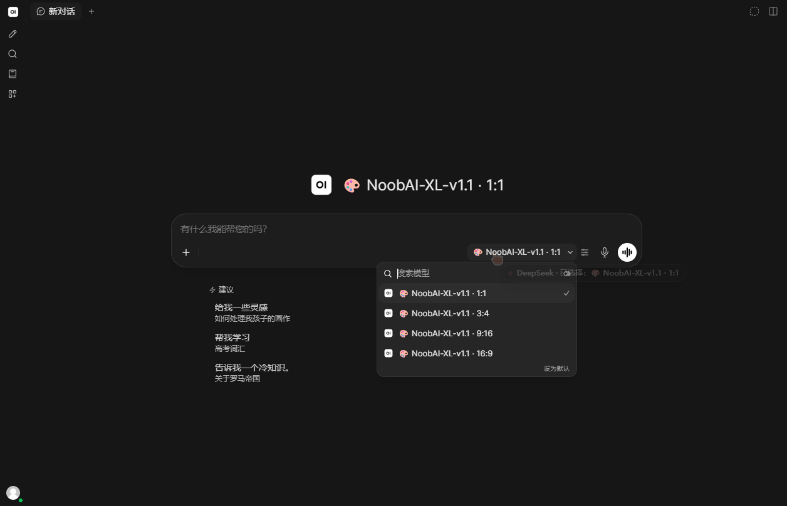 | "选择模型"下拉里 4 条 = 1 个 checkpoint × 4 个比例 |
| 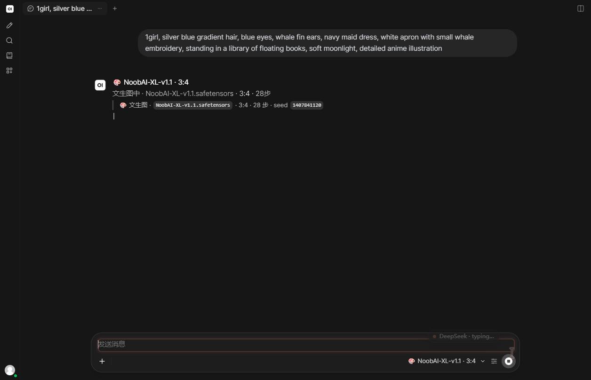 | 回车后先出现状态行（`文生图中 · 3:4 · 28步`）和 seed，然后才是图 |
| 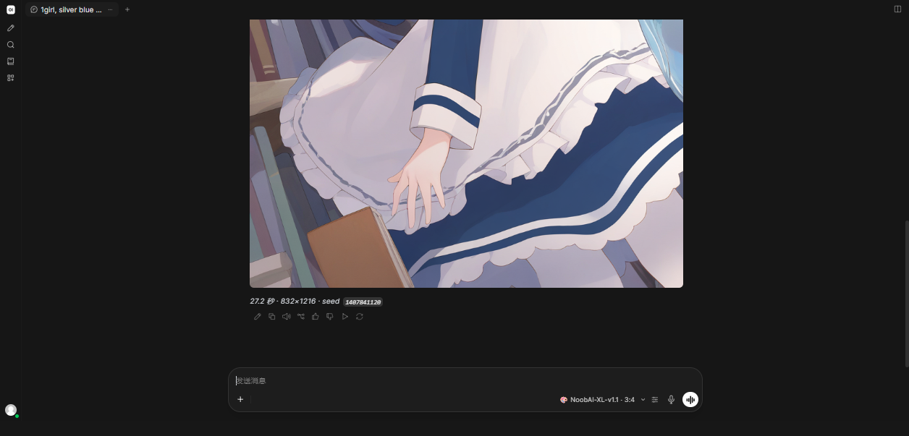 | 图下面是 `25.9 秒 · 832×1216 · seed ...`，方便复现 |
| 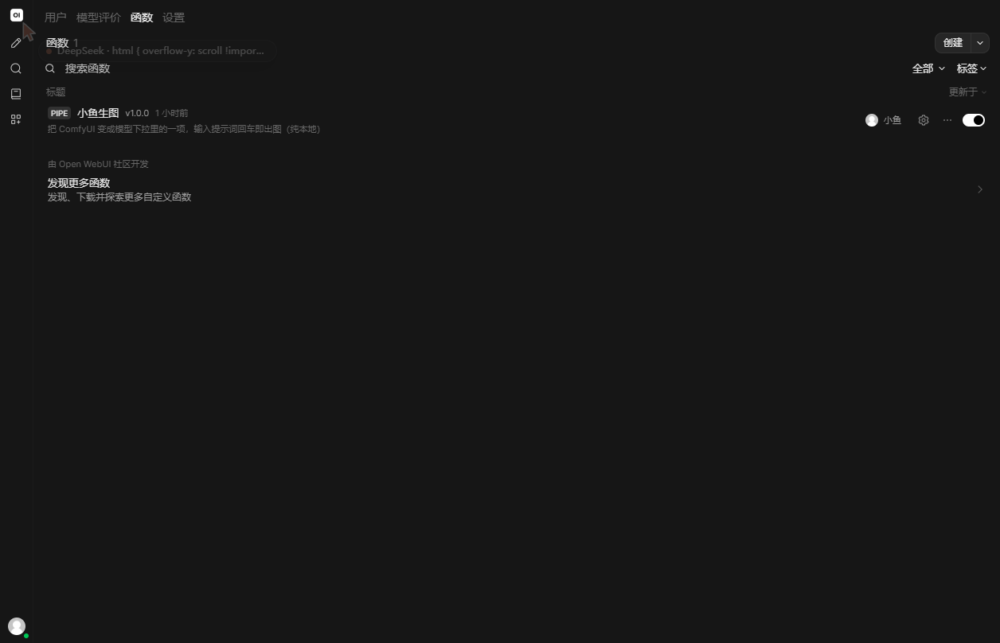 | 管理员面板 → 函数：`PIPE` 标记那条就是，右边开关是总闸 |
| 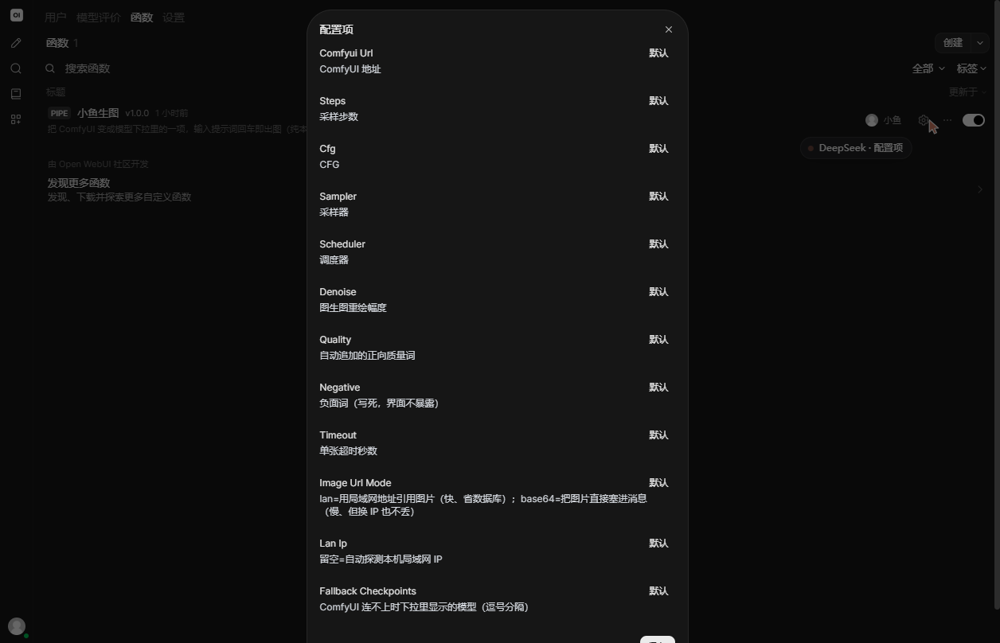 | 那行的**齿轮**弹出"配置项"：步数、CFG、负面词、超时全在这，改了立刻生效 |
| 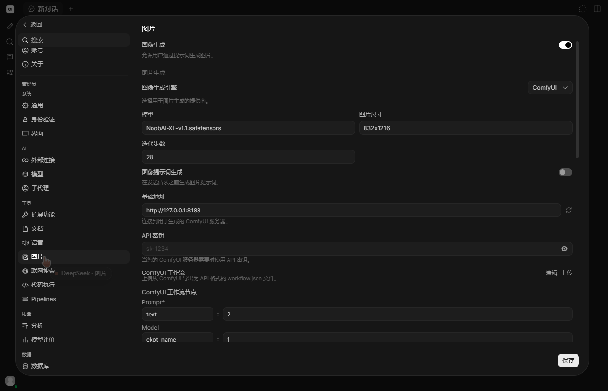 | 管理员面板 → 设置 → 图像：内置引擎（可选）。模型名、尺寸、步数、节点映射都在这 |
| 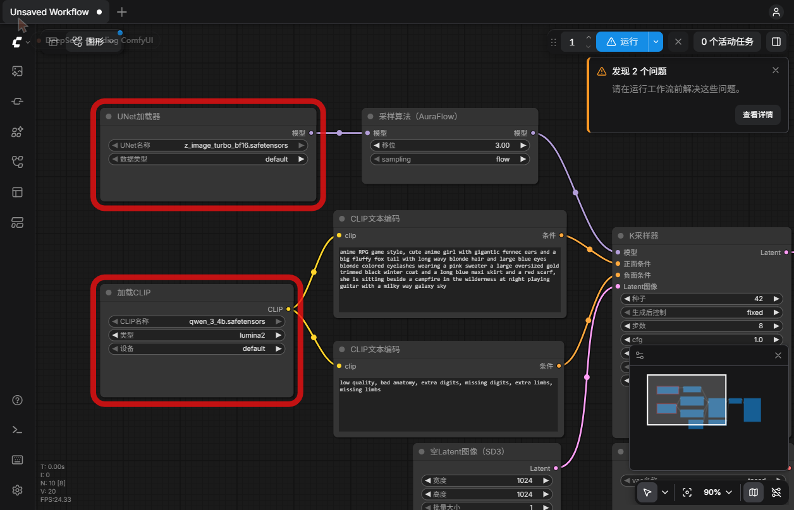 | ComfyUI 本体，节点画布——**用户永远不该看到这一层** |
| 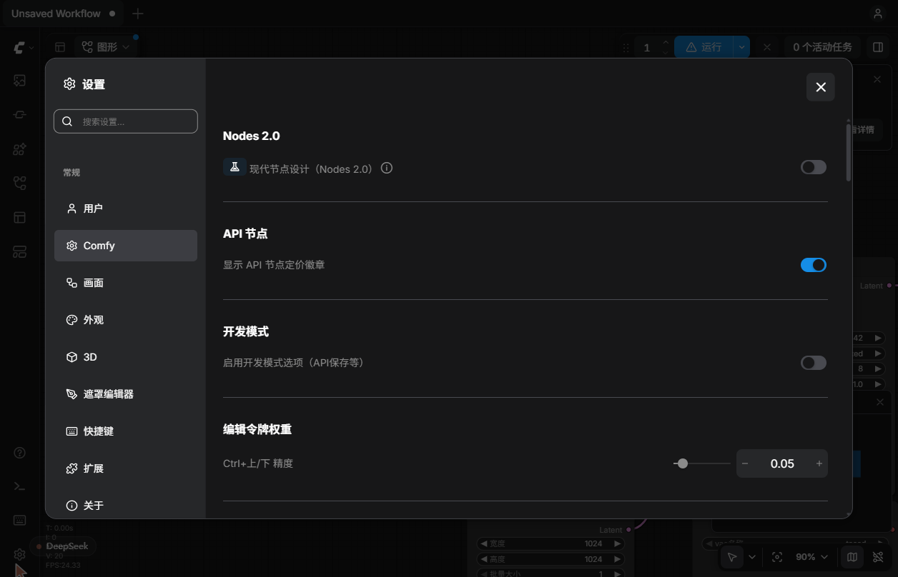 | 设置 → Comfy → **开发模式**开关，导出 API 格式必须打开它 |
| 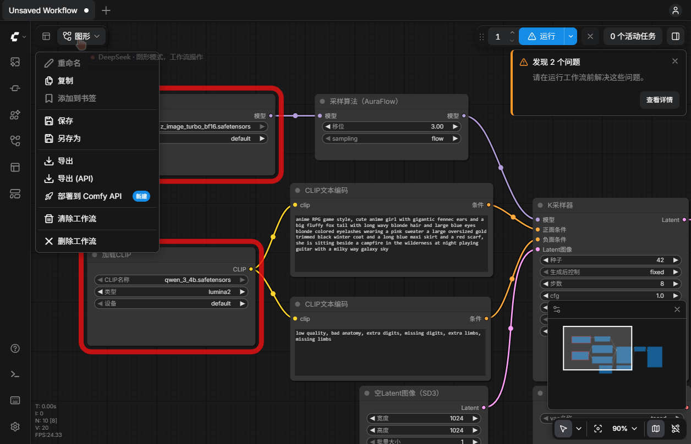 | 打开后：顶部 **图形菜单 → 导出 (API)**，这就是 `/prompt` 要的 JSON |

---

## 参数与 8GB 显存调优

默认值（`pipe/xiaoyu_img.py` 里的阀门，界面可改）：

| 参数 | 默认 | 说明 |
|-|-|-|
| 步数 | 28 | 20 以下明显糊，35 以上只涨时间 |
| CFG | 5.0 | 动漫模型高于 7 容易发白 |
| 采样器 / 调度器 | `euler_ancestral` / `normal` | SDXL 上最稳 |
| 分辨率 | 见比例表 | **总像素别超过约 1.0 MP**，1344×1344 直接 OOM |
| 二次放大 | 关 | 开了多吃 1.5~2 倍显存 |
| 批量 | 固定 1 | 多张一起必 OOM |
| 图生图 denoise | 0.6 | 低了没变化，高了丢原图 |

细节和"怎么只把提示词暴露给用户"见 **[docs/04-tuning.md](docs/04-tuning.md)**。

---

## 排错

速查（完整版见 **[docs/03-troubleshooting.md](docs/03-troubleshooting.md)**）：

| 症状 | 先查什么 |
|-|-|
| 下拉框"暂无可用模型" | 函数开关没拨开；或 `GET /api/models` 里有没有 `xiaoyu_img.*` |
| 出图报 `Cannot connect to ComfyUI` | `curl http://127.0.0.1:8188/system_stats`；注意填的是 **127.0.0.1** 不是 `0.0.0.0` |
| `Value not in list: ckpt_name` | JSON 里的模型名和磁盘上不一致，一字不差 |
| `CUDA out of memory` | 降分辨率 / 关二次放大 / 关别的吃显存程序 |
| 出图成功但图片是坏的 | 手机端多半是 **8188 没放行** |
| 一条消息出了 3 张图 | `__task__` 没接（见原理第 4 节） |

---

## 仓库结构

```
pipe/xiaoyu_img.py          # 核心：Open WebUI Pipe 函数（一个文件就是全部桥接逻辑）
workflows/text2img.json     # 文生图 API 格式工作流（9 节点，可直接用）
workflows/img2img.json      # 图生图 API 格式工作流（denoise 0.6）
scripts/start-all.bat       # 一键启动（等端口就绪 + 打印手机地址 + 开浏览器）
scripts/start-owui.bat      # 只起 Open WebUI（带日志窗口，排错用）
scripts/run_nvidia_gpu.bat  # 改好的 ComfyUI 启动脚本（--listen / --enable-cors-header）
docs/01-deploy.md           # 从零部署（含 Python 版本、镜像源、防火墙、手机）
docs/02-internals.md        # 更细的原理与源码位置
docs/03-troubleshooting.md  # 报错对照表（都是真实报错文本）
docs/04-tuning.md           # 8GB 显存调参
images/                     # 截图与效果图
```

---

## 参考与同类项目

这套东西不是凭空来的。路线来自 Open WebUI 官方文档和社区讨论，同一条路上已经有人走过——都列在下面，写清"它解决什么"和"和本仓库的差别"，方便你挑一个更合手的。

### 官方与上游

| 项目 | 它做什么 / 与本仓库的关系 |
|-|-|
| [open-webui/open-webui](https://github.com/open-webui/open-webui)<br>★159k · Open WebUI 自有许可（含品牌条款） | 界面本体。**Pipe / manifold 机制来自它**——实现时读的是本地装的 0.13.3 源码：`backend/open_webui/functions.py` 的 `get_function_models()`（manifold 分支）和 `generate_function_chat_completion()`（只把签名里写了的参数传进去）。本仓库只调用它的 HTTP 接口和插件接口，**不打包它的代码**。 |
| [open-webui/docs](https://github.com/open-webui/docs) | 官方文档站源码。两页最关键：[Pipe 与"一个函数生成多个模型"](https://github.com/open-webui/docs/blob/main/docs/features/plugin/functions/pipe.mdx)、[ComfyUI 内置引擎（注明是社区贡献教程）](https://github.com/open-webui/docs/blob/main/docs/features/chat-conversations/image-generation-and-editing/comfyui.md)。 |
| [comfyanonymous/ComfyUI](https://github.com/comfyanonymous/ComfyUI)<br>★100k+ · GPL-3.0 | 后端。用到 `/prompt`、`/history`、`/view`、`/object_info`、`/api/upload/image` 五个接口；启动参数的默认值查的是 `comfy/cli_args.py`。 |
| [open-webui/pipelines](https://github.com/open-webui/pipelines)<br>★2.4k · MIT · **2026-10-29 已归档** | 早期做多模型的另一条路（独立服务 + OpenAI 兼容协议）。函数 / Pipe 现在已内建进核心，新项目不必再上这套。 |

### 最接近的同类实现

| 项目 | 它做什么 / 与本仓库的差别 |
|-|-|
| [mayerwin/open-webui-llamaswap-image-models](https://github.com/mayerwin/open-webui-llamaswap-image-models)<br>★6 · MIT | 把图像模型做成下拉项，但**经 llama-swap 转发**，后端可以是 ComfyUI 或 OpenAI 风格。思路几乎一样；多一层 llama-swap 换来"一个入口接多种后端"。本仓库直接打 ComfyUI，少一个进程。 |
| [Haervwe/open-webui-tools](https://github.com/Haervwe/open-webui-tools)<br>★838 · MIT | 大合集：15+ 工具 / 管道 / 过滤器，其中 Flux Kontext 的 ComfyUI 管道形态最接近本仓库。它是工具箱；本仓库只做一件事但做完整（比例、图生图、手机访问、8G 调参）。 |
| [pwillia7/open-webui-tools](https://github.com/pwillia7/open-webui-tools)<br>★15 · 2025-03 后未更新 | 用 JSON 定义 ComfyUI 工作流的 txt2img / img2img 工具。它靠"JSON + 节点映射"来配置，本仓库在 Pipe 里直接拼 dict，少一层配置。 |
| [hoshibayasushi/comfyui-bridge](https://github.com/hoshibayasushi/comfyui-bridge)<br>★2 | 另写一个 FastAPI 服务当桥，Open WebUI 把它当 OpenAI 兼容后端接进来。多一个进程，好处是能跨机器部署、多个前端共用。 |
| [light-and-ray/image-edit-bot-open-webui](https://github.com/light-and-ray/image-edit-bot-open-webui)<br>★7 | bot 形态的 ComfyUI 包装，偏"图 + 提示词"的编辑流。它是 bot 壳，本仓库是聊天界面里的一个模型。 |
| [x-hannibal/open-webui-easymage](https://github.com/annibale-x/open-webui-easymage)<br>★4 · MIT | **filter** 形态的多引擎图像生成：提示词增强、多语言、Vision 打分。它管"生成质量评估"，本仓库只负责把图出出来。 |
| [lalanikarim/comfy-mcp-pipeline](https://github.com/lalanikarim/comfy-mcp-pipeline)<br>★15 · MIT · 2025-02 | 通过 MCP server 桥接 ComfyUI，依赖 `comfy-mcp-server`。走 MCP 协议的早期路线。 |

另外，官方仓库里有个讨论值得看：[open-webui#24154](https://github.com/open-webui/open-webui/discussions/24154)——就是在聊"图像模型进不了模型下拉"，结论和本仓库一样：写成 Pipe。

### 独立实现声明

- 本仓库的 `.py` / `.bat` / `.md` 均为独立编写，**没有从上面任何仓库复制代码**；实现依据是 Open WebUI 0.13.3 的本地源码、ComfyUI 0.45.0 的 `cli_args.py`，以及上面那两份官方文档。
- `workflows/*.json` 是 ComfyUI **核心节点**的标准连法（等于默认示例图的等价物），不含任何第三方自定义节点——这种连法在任何教程里都长得一样，谈不上独创。
- 同一问题被不同人解成同样的形状是正常的：大家能用的是同一套 API（`/prompt` + `/history`）和同一套扩展点（Pipe）。若你发现某段实现与上面项目高度雷同，欢迎开 issue，我们会核对并补上出处。
- 本仓库**不打包** ComfyUI 与 Open WebUI 的任何代码或模型权重，MIT 只覆盖本仓库自身内容。

---

## 已知限制

- **只测了 Open WebUI 0.13.x + ComfyUI 0.45.x**。别的版本接口可能变，`pipes()` 的用法是 0.13 的。
- 比例是固定的 4 档（写死在 `RATIOS`），不是自由拖拽。想加档直接改那个字典。
- 轮询 `/history`，没有走 ComfyUI 的 websocket 进度推送，所以状态行只有"生成中"，没有百分比。
- 图生图的重绘幅度是全局阀门，不能按次调（界面上没有这个入口）。
- 每次出图都在 ComfyUI 的 `output/` 留一份 PNG，没有自动清理。

---

## 许可

MIT。用到的两个上游项目各自有自己的许可： [ComfyUI](https://github.com/comfyanonymous/ComfyUI)（GPL-3.0）、[Open WebUI](https://github.com/open-webui/open-webui)（其自身许可，含品牌条款）。
本仓库只包含桥接代码与文档，不包含模型权重。
