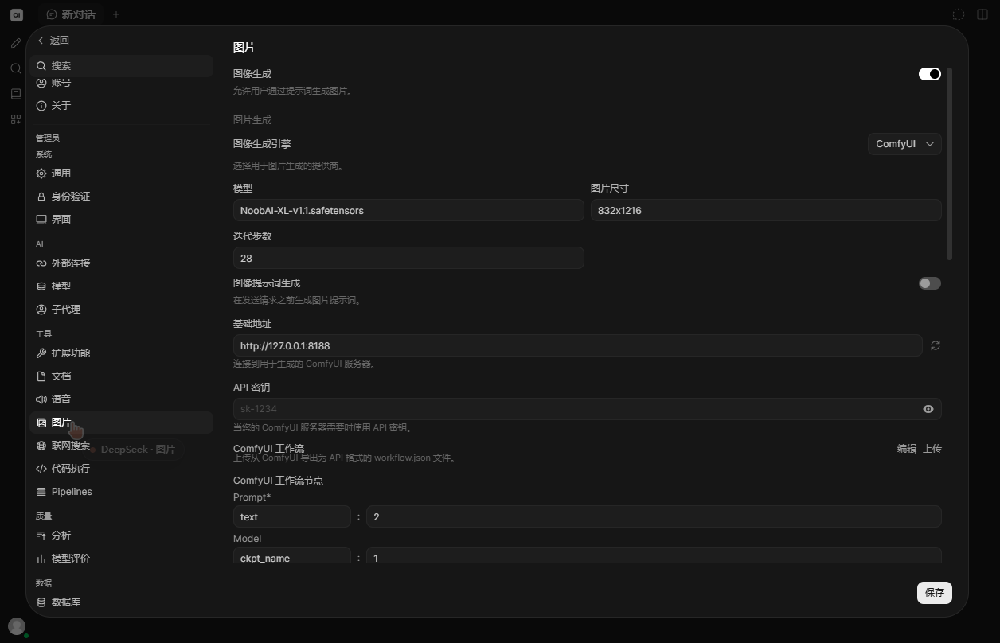
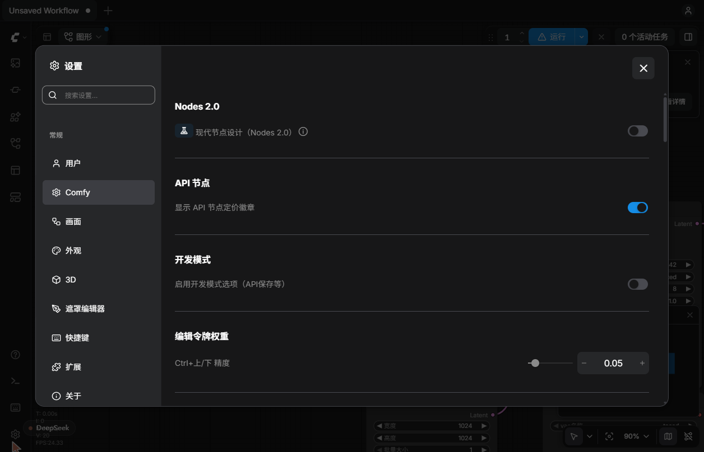
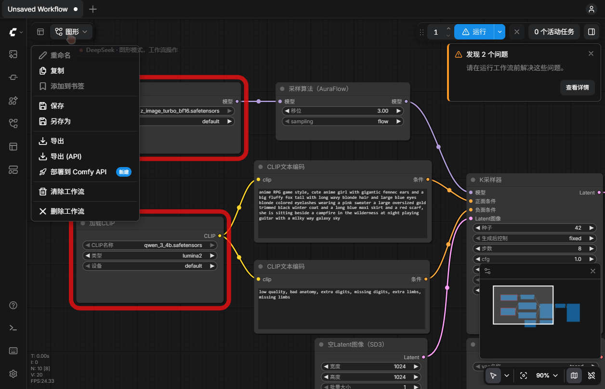
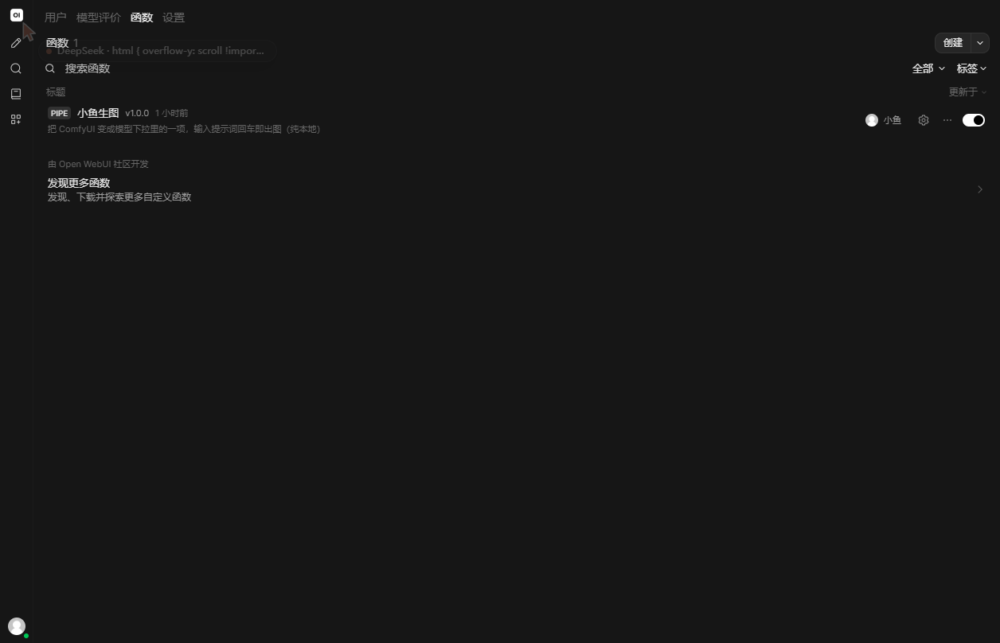
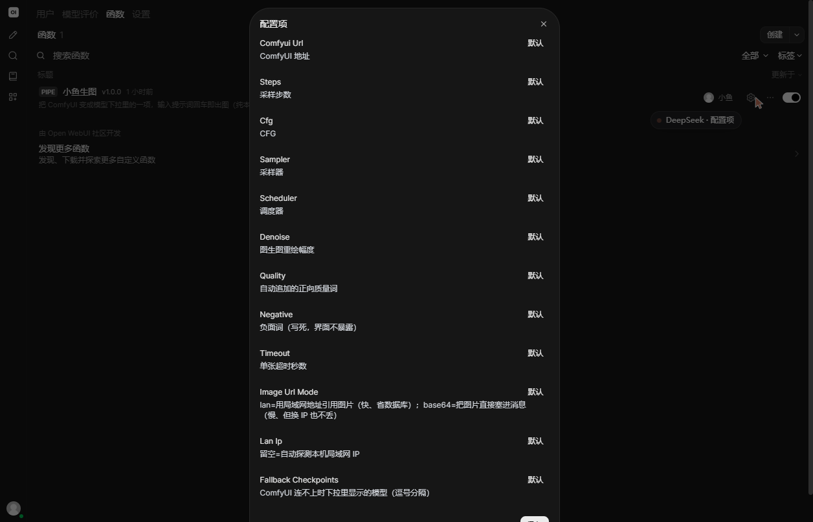

# 从零部署

> 顺序：Python → Open WebUI → ComfyUI 改造 → 绑定 → 手机 → 验收。
> 下面所有路径都可以换，换完记得同步改 `scripts\*.bat` 开头的"改这里"块。

实测环境：Windows 11 笔记本 / RTX 5060 Laptop 8GB / 48 GB 内存 / 驱动 592.15。
实测版本：Open WebUI **0.13.3**、ComfyUI 便携版 **0.45.0**（内置 Python 3.13.14、PyTorch 2.14.1+cu130）。

---

## 1. 装 Python 与 Open WebUI

### 1.1 版本要求

Open WebUI 0.13.3 的 `pyproject.toml`：`requires-python = ">= 3.11, < 3.13.0a1"`。

- **3.13 也不行**（上限是 3.13 的 prerelease 之前），3.14 更不行；
- 系统里如果只有 3.13/3.14，必须另装一个 3.12；
- **不要用 ComfyUI 自带的 `python_embeded`**：它现在是 3.13.14，超版本；而且往里面塞 2.3 GB 别的依赖，ComfyUI 大概率起不来。两者必须是两个 Python。

```bat
winget install --id Python.Python.3.12 -e
py -3.12 -V
```

### 1.2 建 venv 并安装

```bat
py -3.12 -m venv E:\owui
E:\owui\Scripts\python.exe -m pip install -i https://pypi.tuna.tsinghua.edu.cn/simple open-webui
```

- 体积：装完 `E:\owui` 约 **2.3 GB**（`site-packages` 占绝大部分）；
- 耗时：国内宽带 + 清华源约 **8~15 分钟**；
- 想长期用镜像：`%APPDATA%\pip\pip.ini` 加
  ```ini
  [global]
  index-url = https://pypi.tuna.tsinghua.edu.cn/simple
  ```
- 缓存别放 C 盘：设 `PIP_CACHE_DIR=D:\cache\pip`。

**怎么验证**：`E:\owui\Scripts\open-webui.exe --version` 有输出；`E:\owui\Lib\site-packages\open_webui\` 存在。

---

## 2. 改 ComfyUI 启动脚本

### 2.1 改前 / 改后

便携版自带的 `run_nvidia_gpu.bat` 原版只有一行：

```bat
.\python_embeded\python.exe -s ComfyUI\main.py --windows-standalone-build
```

改成（仓库里 `scripts/run_nvidia_gpu.bat` 就是这份）：

```bat
@echo off
cd /d "%~dp0"
.\python_embeded\python.exe -s ComfyUI\main.py --windows-standalone-build --listen 0.0.0.0 --enable-cors-header *
echo If you see this and ComfyUI did not start, update your Nvidia driver.
pause
```

两处改动：

1. **`cd /d "%~dp0"`**：原版用相对路径 `.\python_embeded\...`，一旦被别的 bat 从其他目录 `start` 起来，工作目录不对，它会**瞬间退出且不报错**。这一句保证从哪调用都能跑。
2. 两个参数（见下）。

### 2.2 两个参数是干什么的

| 参数 | 作用 |
|-|-|
| `--listen 0.0.0.0` | 监听**所有网卡**。默认 `127.0.0.1` 只有本机能连，手机连不进来。 |
| `--enable-cors-header *` | 给每个响应加 `Access-Control-Allow-Origin: *`。浏览器同源策略要求这个头，否则网页 fetch 8188 会被拦。 |

> 补充：`--windows-standalone-build` 是便携版自带开关，让程序用便携目录的配置、忽略系统 Python 环境，别删。

如果原文件里已有冲突参数，**替换**而不是追加：

- `--listen 127.0.0.1` → 改 `0.0.0.0`；
- `--enable-cors-header http://localhost:3000` → 改 `*`；
- `--port 8188` 如果改过，OWUI 那边的"基础地址"要跟着改。

**怎么验证**：

```bat
curl http://127.0.0.1:8188/system_stats
```

返回 JSON 里 `system.argv` 应能看到 `--listen`、`0.0.0.0`、`--enable-cors-header`、`*`。浏览器开 `http://127.0.0.1:8188` 能看到节点画布。

---

## 3. 启动 Open WebUI 并绑定（内置引擎，可选）

启动（三个环境变量都要）：

```bat
set "DATA_DIR=E:\owui-data\data"
set "OFFLINE_MODE=true"
set "HF_ENDPOINT=https://hf-mirror.com"
cd /d "E:\owui"
E:\owui\Scripts\open-webui.exe serve --host 0.0.0.0 --port 8080
```

| 变量 | 作用 |
|-|-|
| `DATA_DIR` | 数据写这里，否则写进 `site-packages\open_webui\data`，一升级全丢 |
| `OFFLINE_MODE=true` | 不联 HuggingFace 找向量模型。**不加会被 SSL 报错 + 429 限流拖 110 秒** |
| `HF_ENDPOINT` | 万一要下模型走镜像 |

成功标志（控制台）：

```
INFO:     Application startup complete.
INFO:     Uvicorn running on http://0.0.0.0:8080 (Press CTRL+C to quit)
```

首次打开 `http://127.0.0.1:8080` → 点"注册" → 建管理员账号。**邮箱必须是合法格式且带 TLD**（`admin@local` 会被 400 拒；`admin@example.com` 可以）。

### 绑定内置引擎（可选，只为 REST API）

头像 → **管理员面板** → **设置** → **图像**：

| 字段 | 填 |
|-|-|
| 图像生成 | 开 |
| 图像生成引擎 | `ComfyUI` |
| 模型 | 你的 checkpoint 文件名（如 `NoobAI-XL-v1.1.safetensors`） |
| 图片尺寸 | `832x1216` |
| 迭代步骤 | `28` |
| 基础地址 | `http://127.0.0.1:8188` |
| API 密钥 | 留空 |
| ComfyUI 工作流 | 粘 `workflows/text2img.json` |
| 节点：Prompt | `text` : `2` |
| 节点：Model | `ckpt_name` : `1` |
| 节点：宽/高/步数/seed | `4`/`4`/`5`/`5` |

图生图在同一个页面往下拉（Image Edit 区）：引擎 `ComfyUI`、工作流 `workflows/img2img.json`、映射 image→`20`/`image`、prompt→`2`/`text`、model→`1`/`ckpt_name`，**宽高留空**。

> 为什么宽高要留空：img2img 工作流里没有空 latent 节点，填了 OWUI 会往节点里塞 `width` 字段，ComfyUI 校验直接失败。
> 还要知道：界面上只有 6 行固定映射（prompt/model/width/height/steps/seed），**每保存一次，其它映射会被丢掉**，所以负面词写死在工作流里。



**怎么验证**：`GET /api/v1/models` 或者直接

```bash
curl -X POST http://127.0.0.1:8080/api/v1/images/generations \
  -H "Authorization: Bearer <token>" -H "Content-Type: application/json" \
  -d '{"prompt":"1girl","size":"832x1216"}'
# → {"url": "..."} 且 ComfyUI 的 output 目录多一张图
```

Token 取法：F12 → Application → Local Storage → `token`。

---

## 4. 导出 API 格式工作流

**新前端（1.58.x）的操作**：

1. 打开 `http://127.0.0.1:8188`；
2. 左下角 **齿轮（设置）** → 左侧 **Comfy** → 打开 **开发模式**（"启用开发模式选项（API保存等）"）；
3. 关掉设置 → 点左上角 **图形** 菜单 → **导出 (API)**；
4. 下载 `workflow_api.json`。




**老前端**：设置里打开 `Enable Dev mode Options` 后，工具栏会多出 `Save (API Format)` 按钮。

**怎么验证**：打开 JSON，顶层应该是 `{"1": {"class_type": ...}}` 这种结构。如果是 `{"nodes": [...], "links": [...]}`，那是界面格式，`/prompt` 不认。

如果懒，直接用本仓库的 `workflows/text2img.json`（改一下 `ckpt_name` 就能跑）。

---

## 5. 装 Pipe 函数（这一步才是"输入即出图"）

头像 → **管理员面板** → **函数** → 右上 **创建** → 类型 **Pipe**：

- id：`xiaoyu_img`（只能小写字母/数字/下划线）
- 名称：`小鱼生图`
- 内容：粘 [`pipe/xiaoyu_img.py`](../pipe/xiaoyu_img.py) 全文
- 保存 → 把列表右边那个**开关拨成蓝色**



**怎么验证**：

```bash
curl -H "Authorization: Bearer <token>" http://127.0.0.1:8080/api/models
# 应该看到 4 条 xiaoyu_img.noobai_xl_v1_1__1x1 / __3x4 / __9x16 / __16x9
```

回首页刷新，右下角"选择模型"里就有 `🎨 ... · 1:1` 这几条了。选一个打字回车。

**改参数**：函数列表那一行的**齿轮** → "配置项"面板（步数、CFG、负面词、超时都在里面，改完立刻生效，不用重启）。



---

## 6. 防火墙

手机要能访问，两个端口都得放行：**8080**（界面）、**8188**（图片是浏览器直连这里取的）。

### 图形界面

1. `Win+R` → `wf.msc` → 回车；
2. 左 **入站规则** → 右 **新建规则…**；
3. **端口** → 下一步 → **TCP** → 特定本地端口 `8080,8188` → 下一步；
4. **允许连接** → 下一步 → 域/专用/**公用** 三个都勾（WiFi 常被识别成"公用网络"，不勾就不通）→ 下一步；
5. 名称 `comfy-webui` → 完成。

### 命令行（管理员）

```bat
netsh advfirewall firewall add rule name="comfy-webui-8080" dir=in action=allow protocol=TCP localport=8080 profile=any remoteip=localsubnet
netsh advfirewall firewall add rule name="comfy-webui-8188" dir=in action=allow protocol=TCP localport=8188 profile=any remoteip=localsubnet
```

`remoteip=localsubnet` = 只放行同子网，外网打不进来。

查：`netsh advfirewall firewall show rule name="comfy-webui-8080"`
删：`netsh advfirewall firewall delete rule name="comfy-webui-8080"`

---

## 7. 手机访问

1. 电脑上 `ipconfig` → 找 **WLAN** 那段的 `IPv4 地址`（只认 `10.` / `192.168.` / `172.16~31.`，`169.254.` 是没拿到 DHCP，`26.x` 之类是虚拟网卡）；
2. 手机连**同一个** WiFi，浏览器开 `http://<那个IP>:8080`；
3. 用电脑上同一个账号登录（勾"记住我"），对话/设置与电脑完全一致（同一个数据库）。

连不上按这个顺序查：

| 顺序 | 原因 | 怎么验 |
|-|-|-|
| 1 | 不在同一 WiFi | 对比手机和电脑的 WiFi 名 |
| 2 | 防火墙（最常见） | `netsh advfirewall firewall show rule name="comfy-webui-8080"`；WiFi 是"公用网络"时必须勾公用 |
| 3 | 服务只监听 127.0.0.1 | `netstat -ano | findstr ":8080"` 必须是 `0.0.0.0:8080` |
| 4 | 服务本身没起 | 电脑浏览器开 `127.0.0.1:8080` 好不好使 |
| 5 | 路由器开了 AP 隔离 | 电脑 `ping <手机IP>`，不通基本就是它 |
| 6 | 手机开着移动数据/VPN | 关掉只留 WiFi |
| 7 | IP 变了 | 重新 `ipconfig`；或在路由器里绑定静态 IP |
| 8 | 网页能开但图片是坏的 | 单独测 `http://<IP>:8188/system_stats`，不通就是 8188 没放行 |

---

## 8. 一键启动

`scripts\start-all.bat`（把开头"改这里"的路径改成你的）：

- 先查 8188，没起就 `Start-Process` 起 ComfyUI 并轮询等就绪；
- 再查 8080，没起就带三个环境变量起 Open WebUI 并轮询 `curl` 到 200；
- 最后打印本机 / 手机地址，并 `start` 打开浏览器（加 `nobrowser` 参数可跳过）。

几个必须知道的坑：

- **bat 必须存成 GBK + CRLF**。UTF-8 无 BOM + LF 会让 cmd 按字节切行，报一堆 `'i_check' 不是内部或外部命令`；
- 不要用 `timeout /t`（无 stdin 时会立即报错），用 `ping -n 2 127.0.0.1 >nul`；
- 不要用 `start "标题" /min xxx.bat` 起子脚本（父窗口隐藏时会静默失败），用 `Start-Process -WorkingDirectory`；
- **PowerShell 5.1 没有 `-Environment` 参数**（那是 PS7+），环境变量在 bat 里 `set` 让子进程继承。

开机自启：把 `start-all.bat` 的快捷方式放进 `Win+R` → `shell:startup`。

---

## 9. 验收清单

| # | 动作 | 期望 |
|-|-|-|
| 1 | 双击 `start-all.bat` | 依次出现 ComfyUI ready / Open WebUI ready，并列出手机地址 |
| 2 | 开 `http://127.0.0.1:8080` | 居中输入框，看不到节点连线 |
| 3 | 点"选择模型" | 4 条 `🎨 <模型> · 1:1 / 3:4 / 9:16 / 16:9` |
| 4 | 选 3:4，输入描述，回车 | 先出状态行，20~35 秒后出图，下方有 `xx 秒 · 832×1216 · seed` |
| 5 | 换 1:1 再来一次 | 方图 1024×1024 |
| 6 | `+` → 上传一张图 → 写一句话 → 回车 | 保留原图主体、按提示词改动（图生图） |
| 7 | 手机开 `http://<IP>:8080` | 能登录、能出图、**图片能显示** |
| 8 | 出图时看任务管理器 | 显存峰值 < 8 GB，无 `CUDA out of memory` |
| 9 | 断掉外网 | 照样出图 → 纯本地 |
